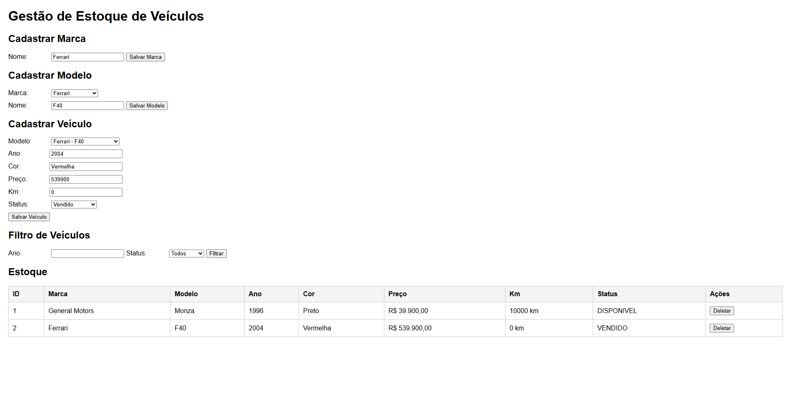
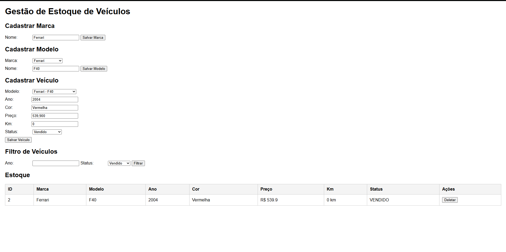
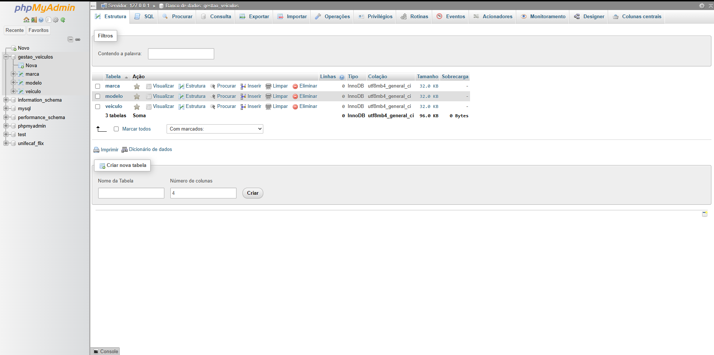
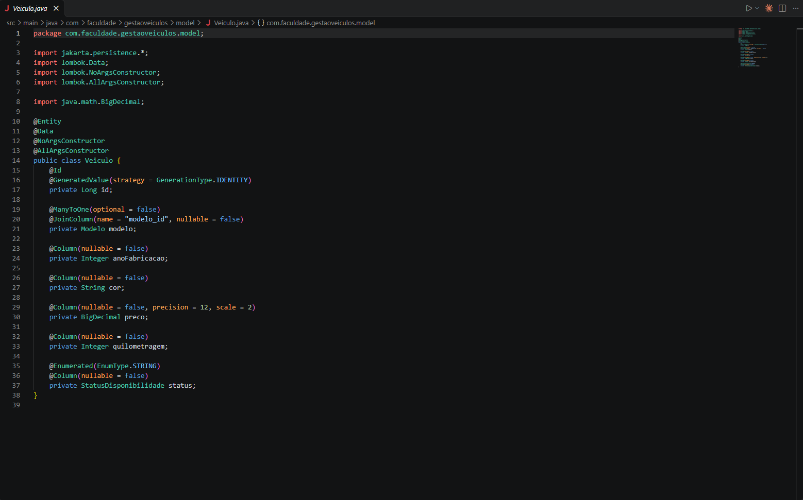
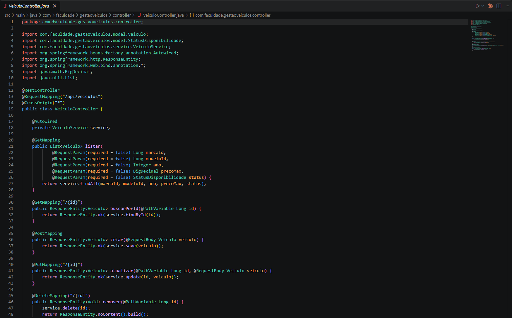
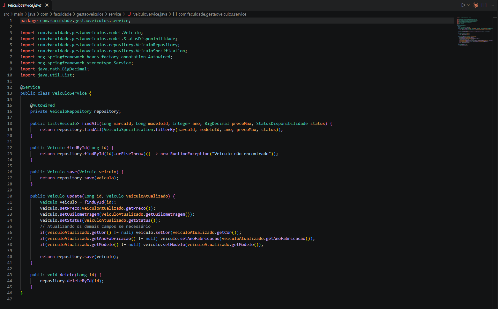
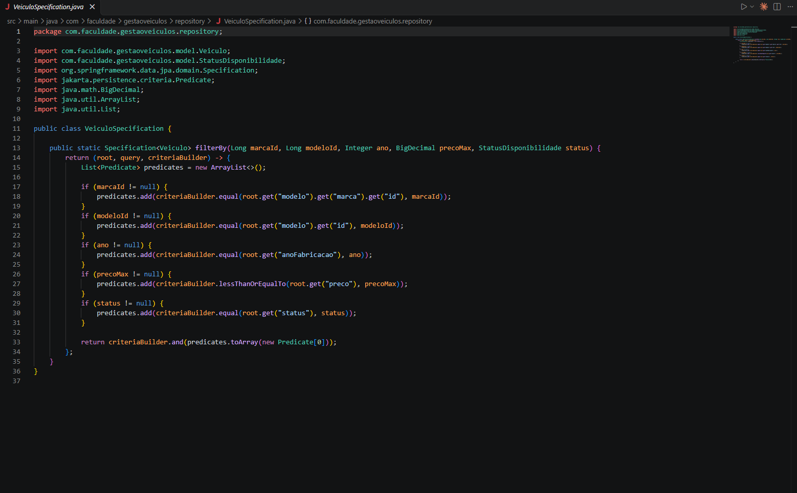

# 🚗 Sistema Automotivo - Gestão de Estoque de Veículos


## 📖 Sobre o Projeto
Este projeto foi desenvolvido como requisito acadêmico para demonstrar a aplicação prática de **Programação Orientada a Objetos (POO)**, desenvolvimento de APIs RESTful e persistência de dados. O sistema resolve o problema de desorganização no estoque de veículos de concessionárias, permitindo o cadastro, consulta, atualização e remoção (CRUD) de veículos, além de suas respectivas marcas e modelos.

---

## 🎯 Funcionalidades Principais
- **Gestão de Marcas e Modelos:** Cadastro e associação estruturada para manter a integridade dos dados.
- **Gestão de Veículos:** Controle completo incluindo cor, ano, preço, quilometragem e status de disponibilidade (Disponível, Vendido, Descontinuado).
- **Filtros Avançados:** Pesquisa otimizada por Marca, Modelo, Ano de Fabricação e Status, utilizando JPA Specifications.
- **Interface Web Integrada:** Front-end simples provido para facilitar a interação e validação dos dados de forma visual.

---

## 💻 Tecnologias Utilizadas
* **Backend:** Java 17, Spring Boot, Spring Data JPA, Hibernate, Maven.
* **Banco de Dados:** MySQL.
* **Frontend:** HTML5, CSS3 e Vanilla JavaScript (Fetch API).
* **Outros:** Lombok (para redução de boilerplate).

---

## ⚙️ Arquitetura e Estrutura
O sistema foi desenhado sobre o padrão arquitetural MVC modificado (padrão de camadas REST):
- `model`: Entidades (classes) representando as tabelas do banco de dados (POO, encapsulamento).
- `repository`: Interfaces de acesso a dados via JPA.
- `service`: Lógica de negócio e regras de sistema isoladas.
- `controller`: Exposição dos endpoints REST para comunicação HTTP.

---

## 🚀 Como Executar o Projeto

### Pré-requisitos
- Java 17+ instalado
- MySQL Server rodando localmente na porta padrão (3306)
- Maven (Opcional caso utilize a IDE para rodar)

### Passo a Passo
1. **Banco de Dados:**
   Abra seu SGBD (ex: phpMyAdmin ou MySQL Workbench) e crie o banco de dados rodando:
   ```sql
   CREATE DATABASE gestao_veiculos;
   ```

2. **Configuração de Acesso:**
   No arquivo `src/main/resources/application.properties`, as credenciais estão configuradas como padrão (`root` sem senha ou `root`/`root`). Altere caso seu MySQL possua senha.

3. **Iniciando a Aplicação:**
   Abra a pasta do projeto na sua IDE favorita (IntelliJ, Eclipse, VS Code) e rode o método `main` da classe `GestaoVeiculosApplication`.

4. **Acessando a Interface:**
   Com a aplicação rodando, abra o navegador e acesse:
   👉 `http://localhost:8080/index.html`

---

## 📸 Demonstração do Sistema (Telas)

<table>
  <tr>
    <td align="center">
      <strong>Interface do Sistema (Index)</strong><br>
      
    </td>
    <td align="center">
      <strong>Filtros em Ação</strong><br>
      
    </td>
  </tr>
  <tr>
    <td align="center" colspan="2">
      <strong>Banco de Dados (MySQL)</strong><br>
      
    </td>
  </tr>
</table>

---

## 💻 Evidências de Código (Orientação a Objetos e REST)

<table>
  <tr>
    <td align="center">
      <strong>Entidade Veiculo (POO e Encapsulamento)</strong><br>
      
    </td>
    <td align="center">
      <strong>Veiculo Controller (REST API)</strong><br>
      
    </td>
  </tr>
  <tr>
    <td align="center">
      <strong>Veiculo Service (Regra de Negócio)</strong><br>
      
    </td>
    <td align="center">
      <strong>Filtros Avançados (JPA Specification)</strong><br>
      
    </td>
  </tr>
</table>

---
Desenvolvido para trabalho acadêmico. 🎓
